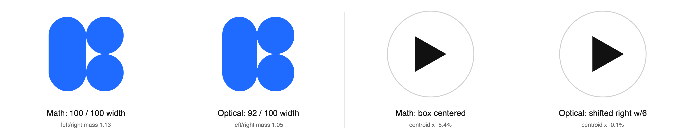
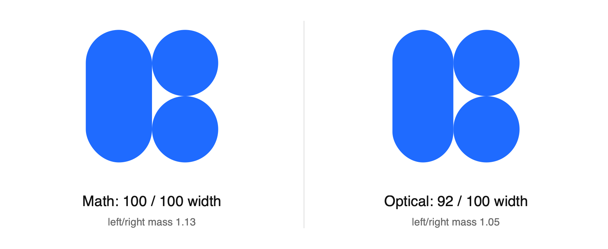
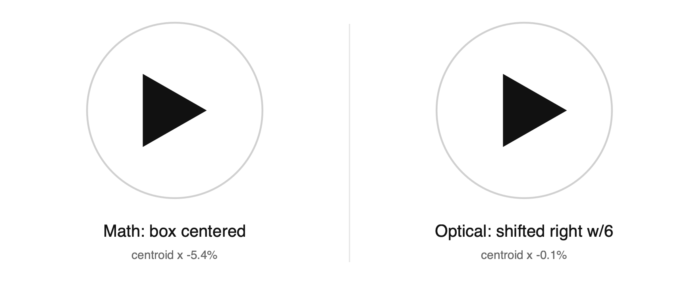
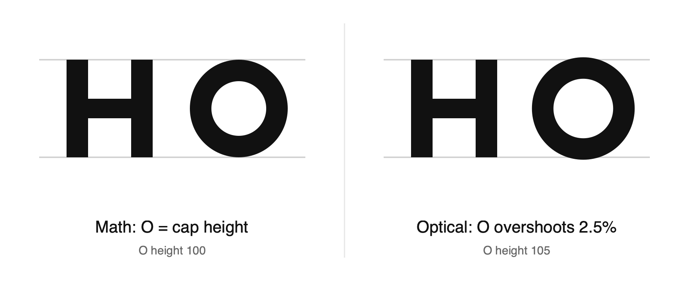
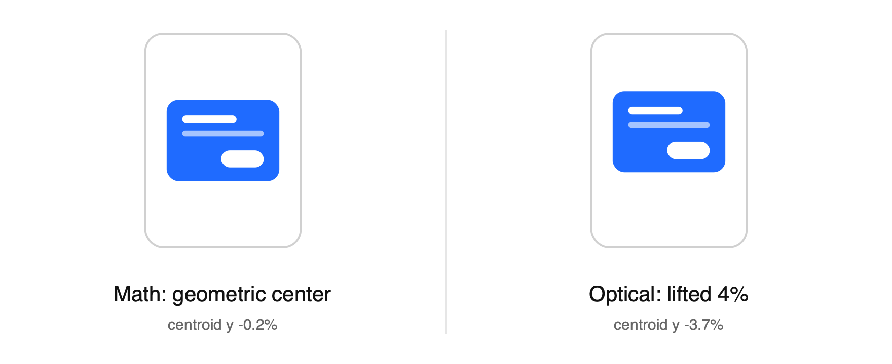
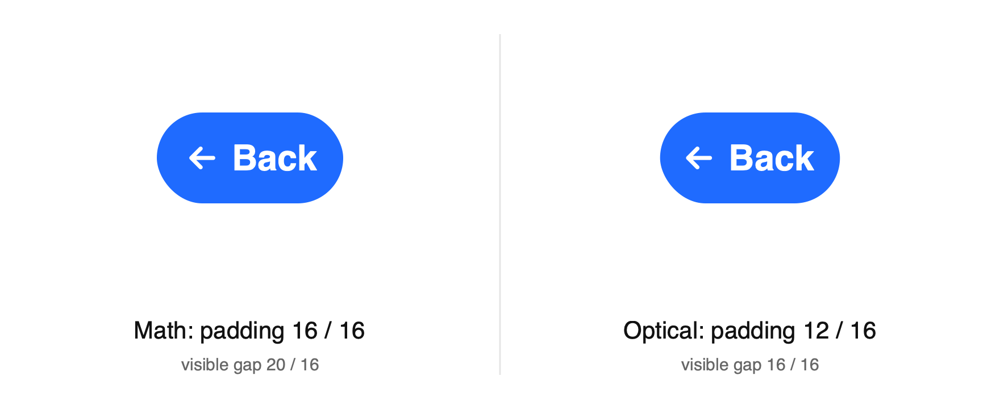

# visually-balanced

**An Agent Skill that teaches AI to design with optical balance, not just math.**

Equal numbers don't always look equal. The eye reads *mass* (area, darkness, complexity), not bounding boxes. This skill gives Claude (and other skill-compatible agents) the rules designers use to correct for that, plus a script that measures visual weight so the corrections can be checked.



Ten math vs optical pairs with measured results are in [Examples](#examples).

## What's inside

```
skills/visually-balanced/
├── SKILL.md                  # 8 optical rules with starting values, workflow, review format
└── scripts/
    └── measure_balance.py    # visual centroid + mass ratios for PNG/JPG/SVG
examples/                     # 10 math vs optical SVG pairs + comparison images
evals/test-prompts.md         # with/without-skill test prompts
```

### The 8 rules
1. Equalize mass, not the bounding box
2. Overshoot round and pointed shapes
3. Center optically (asymmetric shapes, vertical center, directional icons)
4. The top half looks bigger
5. Horizontal strokes look thicker
6. Color and value carry weight
7. Complexity and isolation add weight
8. Optical padding in buttons and icon + text

## Examples

Each pair lives in `examples/` as `NN-name-math.svg` and `NN-name-optical.svg`. Where the script has something to measure, the caption shows its output. Examples 4, 8 and 10 show the geometry change instead.

### 1. Pill and two circles (rule 1)



A pill carries more area than two circles of the same width. Narrowing it 8% brings the two halves close to equal.

### 2. Play icon in a circle (rule 3)



A triangle's mass sits left of its bounding box center. Shifting it right by w/6 puts the centroid on the button's center.

### 3. Square and circle (rule 1)


At the same size the circle has 21% less area and looks smaller. At 112 it matches the square.

### 4. Overshoot (rule 2)



An O that stops at the cap line looks shorter than the H. Letting it pass both lines by 2.5% makes them read as the same height.

### 5. Warning icon in a tile (rule 3)


A triangle's mass sits low in its box, so a box-centered warning icon sags. Moving it up 14px brings the centroid near the center.

### 6. Dialog on a screen (rule 3)



The geometric center reads as slightly low. Lifting the dialog by 4% of the screen height makes it look centered.

### 7. Figure eight (rule 4)


Equal loops look top-heavy. A smaller top loop looks stable, even though the meter now reads bottom-heavy. Numbers guide, eyes decide.

### 8. Plus sign (rule 5)


With equal strokes the horizontal bar looks thicker. Making it 8% thinner lets both bars read the same.

### 9. Dark and light circles (rule 6)


A darker color weighs more at the same size. Growing the lighter circle to 114 evens out the visual weight.

### 10. Icon button padding (rule 8)



The arrow has empty space inside its 24px icon box, so equal padding leaves a wider gap on the icon side. Cutting the icon side to 12 makes the visible gaps equal.

Reproduce any number with the script:

```bash
python skills/visually-balanced/scripts/measure_balance.py examples/03-square-circle-optical.svg --split 0.481
```

## Install

**Claude Code**

```bash
git clone https://github.com/sedatates/visually-balanced.git
cp -r visually-balanced/skills/visually-balanced ~/.claude/skills/
```

Or copy it into a project's `.claude/skills/` folder to scope it to that project.

**Claude apps (claude.ai / desktop)**

Zip the `skills/visually-balanced` folder and upload it as a custom skill in Claude's settings.

**Other agents**

Any tool that supports the Agent Skills format (`SKILL.md` with `name` / `description` frontmatter) can load the folder as is.

## Using the measurement script

```bash
pip install pillow numpy cairosvg   # cairosvg only needed for SVG input

python skills/visually-balanced/scripts/measure_balance.py design.png
python skills/visually-balanced/scripts/measure_balance.py icon.svg --blur blur.png
python skills/visually-balanced/scripts/measure_balance.py layout.png --split 112 --json
```

Example output:

```
size:               240x240
centroid offset:    x -3.6px (-1.5%), y -0.5px (-0.2%)
left/right mass:    1.13  (split at x=120)
top/bottom mass:    1.0  (split at y=120)
-> Left side is heavier (ratio 1.13).
```

Numbers guide, eyes decide. Always check the blurred image too.

## Testing

See [`evals/test-prompts.md`](evals/test-prompts.md). Run each prompt with and without the skill and compare the outputs.

## License

MIT
