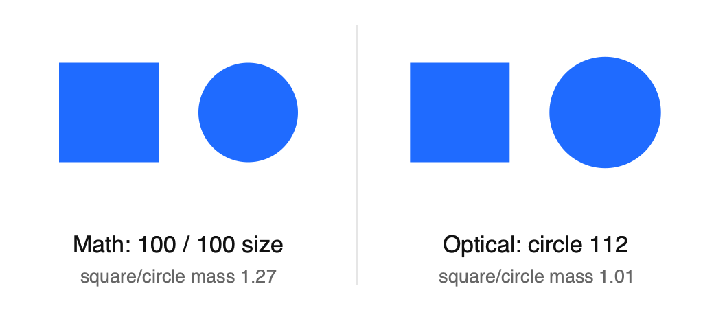
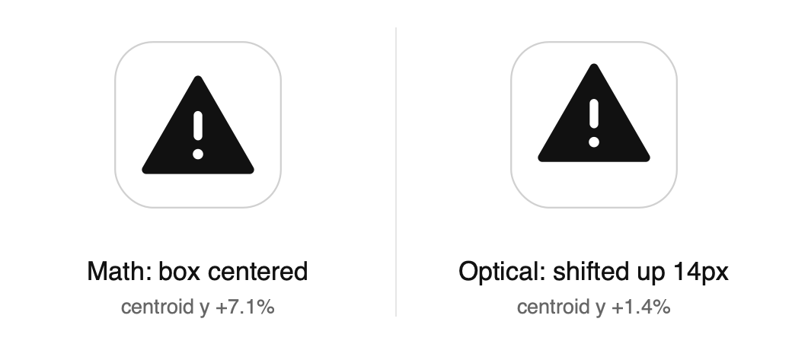
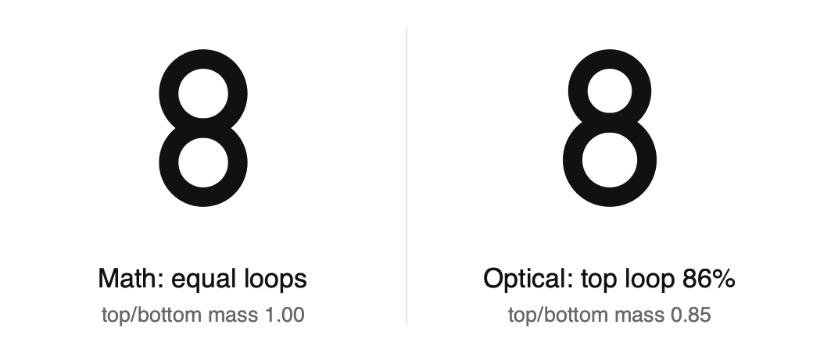
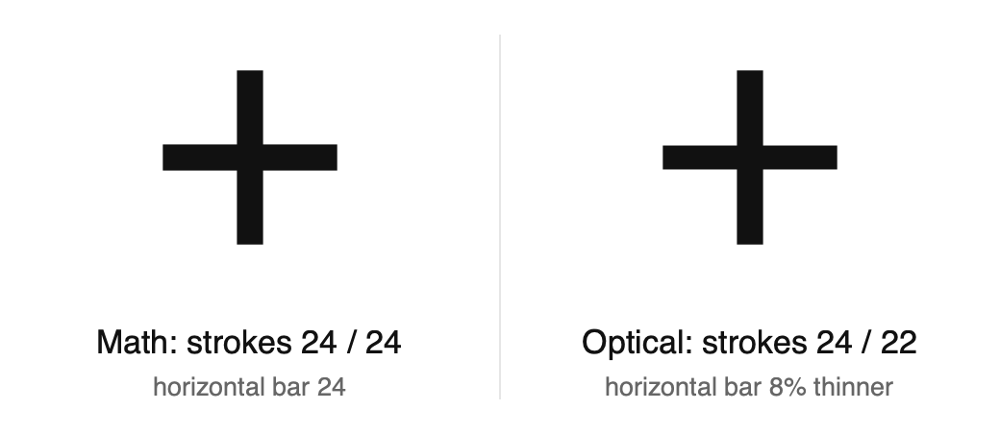
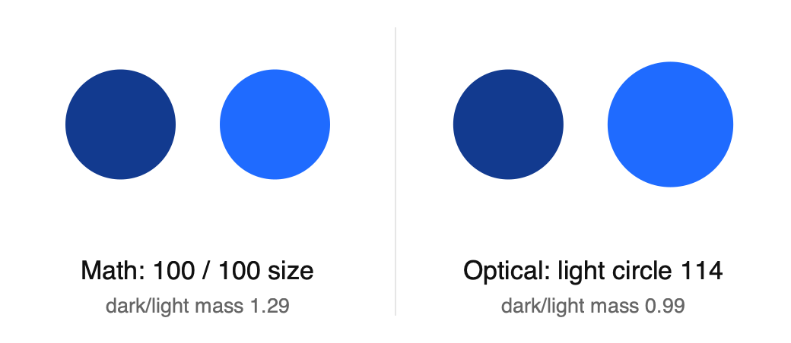

# visually-balanced

**An Agent Skill that teaches AI to design with optical balance, not just math.**

Equal numbers don't always look equal. The eye reads mass (area, darkness, complexity), not bounding boxes. This skill gives Claude and other skill-compatible agents the corrections designers make by eye, with starting values for each, plus a script that measures visual weight so the result can be checked.

## Install

In Claude Code (2.1.275 or later):

```
/plugin install visually-balanced --marketplace sedatates/visually-balanced
```

Then ask for any icon, logo, button or layout. The skill loads on its own when a design needs to look balanced.

<details>
<summary>Other ways to install</summary>

**Older Claude Code versions**

```
/plugin marketplace add sedatates/visually-balanced
/plugin install visually-balanced@visually-balanced
```

**Manual copy**

```bash
git clone https://github.com/sedatates/visually-balanced.git
cp -r visually-balanced/skills/visually-balanced ~/.claude/skills/
```

Copy it into a project's `.claude/skills/` folder instead to scope it to that project.

**Claude apps (claude.ai / desktop)**

Zip the `skills/visually-balanced` folder and upload it as a custom skill in Claude's settings.

**Other agents**

Any tool that supports the Agent Skills format (`SKILL.md` with `name` / `description` frontmatter) can load the folder as is.

</details>

## Math vs optical

Left is what the numbers say. Right is what the skill does.

<table>
<tr>
<td width="50%" valign="top">
<br>
<b>Equal mass, not equal width.</b> A pill outweighs two circles of the same width, so it gets narrower.
</td>
<td width="50%" valign="top">
<br>
<b>Center by mass.</b> A triangle's weight sits left of its box, so the play icon moves right.
</td>
</tr>
</table>

<table>
<tr>
<td width="50%" valign="top">
<br>
<b>Round shapes need more size.</b> At the same size a circle has 21% less area than a square.
</td>
<td width="50%" valign="top">
<br>
<b>Overshoot.</b> An O that stops at the cap line looks short, so it passes both lines a little.
</td>
</tr>
</table>

<table>
<tr>
<td width="50%" valign="top">
<br>
<b>Asymmetric shapes sag.</b> A triangle is heavy at the base, so the warning icon moves up.
</td>
<td width="50%" valign="top">
<br>
<b>The true center reads low.</b> A dialog looks centered when it sits slightly above the middle.
</td>
</tr>
</table>

<table>
<tr>
<td width="50%" valign="top">
<br>
<b>The top half looks bigger.</b> Equal loops look top-heavy, so the top one shrinks.
</td>
<td width="50%" valign="top">
<br>
<b>Horizontal strokes look thicker.</b> The horizontal bar gets thinner so both read the same.
</td>
</tr>
</table>

<table>
<tr>
<td width="50%" valign="top">
<br>
<b>Darker weighs more.</b> The lighter circle grows until the visual weight evens out.
</td>
<td width="50%" valign="top">
<br>
<b>Icons carry their own padding.</b> Less padding on the icon side makes the visible gaps equal.
</td>
</tr>
</table>

The grey captions are output from the measuring script, except for overshoot, strokes and padding, which show the geometry change. Every pair is in [`examples/`](examples) as SVG. All 8 rules with their starting values are in [`SKILL.md`](skills/visually-balanced/SKILL.md).

## Measure it

`measure_balance.py` treats darkness as weight and reports the visual centroid and mass ratios of a PNG, JPG or SVG.

```bash
pip install pillow numpy cairosvg   # cairosvg only needed for SVG input

python skills/visually-balanced/scripts/measure_balance.py design.png
python skills/visually-balanced/scripts/measure_balance.py icon.svg --blur blur.png
python skills/visually-balanced/scripts/measure_balance.py examples/01-pill-mass-math.svg --split 0.5
```

The last command prints:

```
size:               800x800
centroid offset:    x -10.6px (-1.3%), y -0.5px (-0.1%)
left/right mass:    1.129  (split at x=400)
top/bottom mass:    1.0  (split at y=400)
-> Left side is heavier (ratio 1.129).
```

Numbers guide, eyes decide. The figure eight above looks right even though the meter reads bottom-heavy, so always check the blurred image too.

## Testing

[`evals/test-prompts.md`](evals/test-prompts.md) has 8 prompts. Run each with and without the skill and compare the outputs.

## License

MIT
